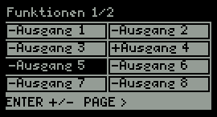
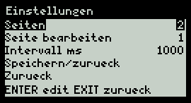
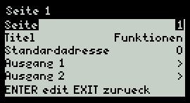
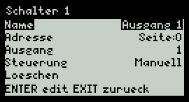

= MultiSwitchNG (mswNG) fuer monochrome EdgeTX-LCDs

== Installation

Den gemeinsamen Unterordner `SCRIPTS/LIB/mswNG` auf die SD-Karte kopieren.
Er benoetigt `app.lua`, `core.lua`, `ui.lua`, `editor.lua` und `storage.lua`;
`tests` und `images` werden auf dem Sender nicht benoetigt.

Fuer den normalen Modellbetrieb `SCRIPTS/TELEMETRY/mswNG.lua` kopieren
und im Modell als Telemetrie-Skript auswaehlen.
Alternativ `SCRIPTS/TOOLS/mswNG.lua` kopieren und _MultiSwitchNG_ im Tools-Menue starten.
Beide Einstiege verwenden denselben Code und dieselben Konfigurationsdateien.
Im Modell muss ein zum gewaehlten Protokoll passendes Sendemodul aktiviert sein:
CRSF/ExpressLRS oder S.Port.
Das bisherige Telemetrie-Skript und die Widgets bleiben unveraendert.

== Bedienung

.Funktionsseite mit acht Schaltern und Seitenanzeige

* Drehgeber bzw. Navigationstasten: Schalter oder Menueeintrag auswaehlen.
* ENTER: ausgewaehlten rastenden Schalter zwischen Aus und Ein umschalten.
  `+` bedeutet Ein, `-` bedeutet Aus; die Hervorhebung zeigt die Auswahl.
  Ein `T` vor dem Namen kennzeichnet einen Taster, der mit der Menutaste bedient wird.
  Ein zusaetzliches `>` vor dem Namen kennzeichnet einen von EdgeTX gesteuerten
  Ausgang: ENTER veraendert dessen Zustand nicht.
* PAGE / PAGE lang: naechste / vorherige Seite.
  Alternativ den Eintrag `Seite >` am Ende des Schalterrasters verwenden.
* `Setup` am Ende des Rasters: Einstellungen oeffnen.
* Menutaste (`EVT_VIRTUAL_MENU`): global konfigurierbare Aktion,
  standardmaessig ohne Funktion. Die physische Taste haengt vom Sender ab,
  beispielsweise MENU, MODEL, SHIFT oder die rechte Navigationstaste.
* EXIT: eine Menueebene zurueck bzw. Tool beenden.
  Bei ungespeicherten Aenderungen stehen Speichern, Verwerfen oder Zurueck zur Wahl.
  In der Telemetrievariante bleiben Laufzeitkonfiguration und manuelle Zustaende
  beim Verlassen der Anzeige erhalten; vor einem Modellwechsel bzw. Neustart speichern.

Das Raster berechnet Spalten, Zeilen und Zellenabmessungen aus `LCD_W` und `LCD_H`.
Auf kleinen Displays werden zusaetzliche Schalter und Menueeintraege
automatisch mit der Auswahl gescrollt.

== Einstellungen

Der Eintrag `Softwareversion` zeigt die Softwareversion an, aktuell `6`.
Er ist nicht editierbar und unabhaengig von der Version des Speicherformats.

Die globale Einstellung `Menutaste` bestimmt die Aktion auf der Funktionsseite:

* `Aus` (Standard): keine Skriptaktion.
* `Bedienung`: ausgewaehlten rastenden Schalter beim Druecken einmal umschalten;
  einen Taster beim Druecken einschalten und beim Loslassen ausschalten.
  Die Eintraege `Seite >` und `Setup` lassen sich damit ebenfalls aktivieren.
* `Naechste Seite`: beim Loslassen zur naechsten Seite wechseln,
  nach der letzten wieder zur ersten.
* `Setup`: beim Loslassen die Einstellungen oeffnen.

Im Editor bleiben ENTER und EXIT fuer Bestaetigung und Rueckkehr zustaendig;
die konfigurierte Menutastenaktion wird dort nicht ausgefuehrt.
Auch bei deaktivierter Menutaste bleibt `Setup` im Raster erreichbar.
Die Einstellung wird zusammen mit der restlichen Konfiguration gespeichert.

Es gibt eine bis vier Seiten mit anfangs jeweils acht Schaltern.
Jede Seite kann null bis zwoelf Schalter enthalten (maximal 48 insgesamt).
Neue Seiten erhalten die erste vollstaendig freie Adresse und die Ausgaenge 1 bis 8.

.Allgemeine Einstellungen

Unter `Seite bearbeiten` lassen sich die Seite und ihre Standardadresse auswaehlen,
ein eigener `Titel` mit bis zu 20 ASCII-Zeichen einstellen,
Schalter bearbeiten und Schalter hinzufuegen.
Der Titel steht in der Kopfzeile. Seitennummer und Aenderungsmarkierung
bleiben sichtbar; bei Platzmangel wird nur der angezeigte Titel gekuerzt.
Neue Seiten und bestehende Konfigurationen ohne Titel verwenden zunaechst `Funktionen`.

.Seiteneinstellungen mit Titel und Standardadresse

Neue Schalter verwenden zuerst einen freien Ausgang an der Standardadresse,
danach an der naechsten freien Adresse (nach 255 folgt 0).
Geloeschte Ausgaenge werden dabei wiederverwendet.
Das Loeschen eines Schalters oder ganzer Seiten muss bestaetigt werden.

Jeder Schalter besitzt einen Namen mit bis zu zwoelf ASCII-Zeichen,
eine Adresse und eine Ausgangsnummer von 1 bis 8.
`Typ` waehlt zwischen `Schalter` (rastend, Standard) und `Taster`.
Fuer manuelle Taster muss die globale Einstellung `Menutaste` auf `Bedienung` stehen.
ENTER schaltet Taster nicht ein, sondern zeigt einen Bedienhinweis.
Die vorhandene Zuordnung unter `Steuerung` hat unabhaengig vom Typ Vorrang.
Die Adresse `-1`, angezeigt als `Seite:...`, uebernimmt die Standardadresse der Seite.
Individuelle Adressen bleiben von Aenderungen der Standardadresse unberuehrt.
Eine Kombination aus Adresse und Ausgang kann nur einmal vergeben werden,
auch seitenuebergreifend.

.Einstellungen eines einzelnen Schalters

`Steuerung` waehlt zwischen `Manuell` und einer nativen EdgeTX-Schalterkennung.
Die Auswahl verwendet die verfuegbaren EdgeTX-Schalterpositionen, einschliesslich
physischer und logischer Schalter sowie invertierter Positionen.
Eine aktive Position ergibt Ein, eine inaktive Aus.
Die Einstellung wird mit ENTER geoeffnet, mit den Navigationstasten geaendert
und mit ENTER bestaetigt; EXIT bricht ab.
Ausgewertet werden immer alle Seiten, auch ausserhalb der sichtbaren Seite.
Unverfuegbare Zuordnungen oder eine fehlende Schalter-API werden gemeldet;
betroffene Ausgaenge werden auf Aus gesetzt.
Native Kennungen sind sender-/firmwareabhaengig: Nach Uebernahme einer Konfiguration
auf einen anderen Sendertyp die Zuordnungen kontrollieren.

Zahlen mit ENTER zur Bearbeitung oeffnen, mit dem Drehgeber aendern
und mit ENTER bestaetigen; EXIT verwirft die Eingabe.
Beim Namen aendern die Navigationstasten das hervorgehobene Zeichen,
ENTER wechselt zum naechsten Zeichen, PAGE bestaetigt den gesamten Namen.
PAGE lang geht ein Zeichen zurueck, EXIT bricht die Namenseingabe ab.
Nach dem letzten Zeichen (12 beim Schalternamen, 20 beim Seitentitel) bestaetigt auch ENTER.

`Protokoll` waehlt global zwischen `CRSF` (Standard) und `S.Port WM`.
Alle Seiten verwenden dasselbe Protokoll.
Bei WM sind zusaetzlich `Physical-ID` (0 bis 27, Standard 0) und
`App-ID` (0 bis 255, Standard 81 bzw. `0x51`) einstellbar.
Diese IDs bleiben auch bei CRSF gespeichert, sind dort aber ohne Wirkung.

Die CRSF-Zieladresse ist fest auf Broadcast `0x00` eingestellt.
Die Schalteradressen (0 bis 255) bleiben unabhaengig davon konfigurierbar.
Das Wiederholintervall ist von 50 bis 10000 ms einstellbar (Standard: 1000 ms).
Schalterbetaetigungen werden unabhaengig vom Intervall sofort zur Uebertragung
vorgemerkt. API-/Sendefehler werden angezeigt; ausstehende Daten werden wiederholt versucht.
Eine erfolgreiche Uebergabe an das Sendemodul ist keine Empfangsbestaetigung.
Sehr kurze Tasterbetaetigungen koennen bei belegter Sendewarteschlange unuebertragen
bleiben; das Skript stellt nach dem Loslassen keinen verzoegerten Ein-Impuls zu.

Die CRSF-Uebertragung verwendet SET4 (`0x07`) fuer eine Adresse bzw.
SET4M (`0x09`) fuer mehrere Adressen, hoechstens 18 Adressgruppen pro Paket.
Beide verwenden die MultiSwitch-Realm `0xa1`, Quelle `0xea` und Big-Endian-Zustandswoerter.
Die Bedienung verwendet wie das Telemetrie-Skript die Zustaende 0 (Aus) und 1 (Ein).
Siehe https://github.com/wimalopaan/Electronics/blob/main/docs/protocols.adoc#crsf_sw[Protokoll].

S.Port WM verwendet dasselbe Zustandswort mit zwei Bits pro Ausgang:

----
sportTelemetryPush(physicalId, 0x31, appId * 256 + address, state)
----

Das untere Byte der Data-ID ist die Schalteradresse, das obere die `App-ID`.
Pro Aufruf werden hoechstens acht Adressen geprueft und ein Telegramm gesendet.
Ein umlaufender Zeiger verarbeitet alle Adressen fair, auch nach abgelehnten
Sendeversuchen oder Aenderungen anderer Schalter. Nur der Rueckgabewert `true`
gilt als Annahme. Abgelehnte Adressen bleiben mit ihrem aktuellen Zustand
ausstehend; der Fehler bleibt auch nach erfolgreichen Sendungen anderer Adressen sichtbar.
Das konfigurierte Intervall gilt je Adresse.
Das angesprochene Geraet darf nicht bereits als Telemetriesensor in EdgeTX
registriert sein, da dies die Ausgabe blockieren kann. Eine Ablehnung meldet
deshalb HF-Konfiguration, FIFO und Sensorkonflikte als moegliche Ursachen.
ACW und weitere Widget-Sonderfunktionen sind nicht Bestandteil von mswNG.

Bei Protokollwechsel sowie WM-ID-Aenderungen werden zuvor erfolgreich
eingeschaltete Adressen ueber den alten Transport mit den alten IDs ausgeschaltet.
Diese Abschaltungen bleiben auch ueber weitere Aenderungen erhalten.
Abschaltungen des aktuellen Protokolls haben Vorrang; ein nicht mehr erreichbares
altes Protokoll blockiert dagegen nicht die neue Ausgabe.
`Alte Abschaltung ausstehend` bleibt sichtbar, bis alle Nulltelegramme angenommen wurden.
Vor dem Umstellen des HF-Moduls daher moeglichst alle Ausgaenge ausschalten und
die erfolgreiche Uebergabe abwarten; ein unerreichbarer Empfaenger kann nicht
zuverlaessig ausgeschaltet werden.

== Speicherung und Laufzeit

`Speichern/zurueck` speichert die Einstellungen. `Zurueck` uebernimmt sie
zunaechst nur fuer die laufende Sitzung; ein Stern markiert ungespeicherte Aenderungen.
Die Dateien `model-<hexkodierter Modellname>.a` und `.b` liegen in `SCRIPTS/LIB/mswNG`.
Ein umbenanntes Modell erhaelt eine eigene Konfiguration; gleichnamige Modelle
teilen sich die Dateien.
Es gibt keine automatische Uebernahme der alten Telemetrie-/Widget-Konfiguration.
Bestehende mswNG-Konfigurationen in den Dateiformaten 1 bis 4 werden weiterhin gelesen;
die fruehere CRSF-Zieladresse wird ignoriert. Sie erhalten die Menutastenaktion `Aus`
und fuer alle Schaltflaechen den Typ `Schalter`, soweit diese Angaben noch fehlen.
Alle alten Formate verwenden zunaechst CRSF und die Standard-WM-IDs.
Beim Speichern wird Format 5 mit zusaetzlicher Protokollauswahl und WM-IDs
ohne CRSF-Zieladresse verwendet. Aeltere Skriptversionen koennen Format 5 nicht lesen.

Gespeichert wird abwechselnd in zwei Dateien mit Generation und Pruefsumme.
Die zuletzt gueltige Datei bleibt beim Schreiben unangetastet;
die neue Datei wird vor der Erfolgsmeldung vollstaendig zurueckgelesen.
Eine defekte Datei fuehrt zu einem Hinweis und gegebenenfalls zum Rueckgriff
auf die andere Datei. Sind beide vorhandenen Dateien unbrauchbar, startet das Tool
mit einer Fehlermeldung statt stillschweigend mit anderen Adressen zu senden.
In diesem Fall die Dateien am PC pruefen bzw. gezielt sichern und entfernen.

Schaltzustaende werden nicht gespeichert: Beim Start sind manuelle Ausgaenge Aus,
zugeordnete Ausgaenge folgen vor der ersten Sendung dem aktuellen EdgeTX-Schalterzustand.
Beim Umadressieren oder Loeschen werden betroffene bisherige Ausgaenge ausgeschaltet;
entfallene Adressen bleiben bis zur erfolgreichen FIFO-Uebergabe ihres Nullzustands
vorgemerkt. WM erzeugt Abschaltungen nur fuer zuvor erfolgreich eingeschaltete Adressen.

Die Telemetrievariante fragt Schalter ab und sendet auch bei geschlossener Anzeige
ueber ihren `background()`-Aufruf. Die Vordergrundanzeige verwendet denselben
Laufzeitkern; das Verlassen der Anzeige setzt manuelle Schaltzustaende nicht zurueck.
Ausgenommen sind gehaltene manuelle Taster: Loslassen, Navigation, EXIT und Speichern
setzen sie auf Aus. Falls beim Wechsel zu einer anderen Senderanzeige das
Loslassereignis fehlt, setzt der Hintergrundaufruf sie nach mindestens einer Sekunde
ohne Vordergrundaufruf zurueck. Normale Hintergrundaufrufe zwischen sichtbaren
Bildaufbauten unterbrechen das Halten nicht; auch Tasten ohne Wiederholereignisse
koennen dauerhaft gehalten werden. Das Ausschalten unterliegt weiterhin der
Verfuegbarkeit der Sendewarteschlange.

ENTER lang bleibt eine Senderfunktion und wird nicht fuer Taster verwendet.
`Aus` deaktiviert nur die Skriptaktion, nicht die Firmware-Funktionen der Taste.
In der Tools-Variante kann insbesondere eine physische MENU-Taste bei langem Halten
die EdgeTX-Lua-Statistikanzeige umschalten. Fuer dauerhaften Modellbetrieb ist die
Telemetrievariante vorgesehen; die konkrete Tastenbelegung am Sender pruefen.

IMPORTANT: Ein Tools-Skript sendet nur, solange es geoeffnet ist.
Nach dem Beenden werden keine Daten wiederholt und kein automatisches
Alles-Aus gesendet; das Verhalten haengt dann vom Empfaenger und dessen Timeout ab.
Vor dem Beenden bei Bedarf die Schalter ausschalten und Sendefehler abwarten.
Tools und Telemetrie sind alternative Betriebsarten, keine parallel synchronisierten
Bedienoberflaechen. Standalone-Tools koennen die Ausfuehrung der Modellskripte
unterbrechen bzw. deren Neuladen ausloesen. Fuer dauerhafte Schaltersteuerung
die Telemetrievariante verwenden und ihre Einstellungen direkt dort bearbeiten.
Das Skript nur einmal im Modell einrichten.
Nicht gleichzeitig mit anderen Skripten dieselben Schalteradressen ansteuern:
SET4/SET4M und WM uebertragen immer alle acht Ausgaenge einer Adresse,
auch nicht im Tool belegte Ausgaenge als Aus.

Fuer niedrigen RAM-Bedarf verwendet mswNG kompakte Datenarrays statt
eines allgemeinen UI-Frameworks und erzeugt keine UI-Objekte pro Schalter.
Der Editor wird erst beim Oeffnen der Einstellungen geladen und danach freigegeben.
Die LCD-Oberflaeche wird ebenfalls erst im Vordergrund geladen und nach mindestens
einer Sekunde ohne Vordergrundaufruf im Hintergrund freigegeben.
Interleavte Hintergrundaufrufe bei sichtbarer Anzeige unterbrechen die Bearbeitung nicht.
Das Speichermodul wird nur zum Laden/Speichern gehalten.
Dateizugriffe erfolgen schrittweise mit hoechstens 96 Byte pro Lesezugriff
und einem Datensatz pro Aufruf. Der Sendepuffer wird wiederverwendet;
es entsteht keine unbegrenzt wachsende Warteschlange.
EdgeTX kann mit `loadScript(..., "btd")` kompilierte Skripte ohne Debuginformationen verwenden.

== Host-Tests

Aus `SCRIPTS/TOOLS`:

----
lua ../LIB/mswNG/tests/run.lua
lua ../LIB/mswNG/tests/memory.lua
lua ../LIB/mswNG/tests/memory.lua sport
----

Die Tests emulieren die EdgeTX-Datei- und LCD-APIs sowie die Sendewarteschlange.
Der separate Speichercheck verwendet 48 Schalter an 48 Adressen und prueft
auf zurueckgehaltene Editormodule bzw. wachsenden Laufzeitspeicher.
Seine KiB-Werte stammen von der Host-Lua-Version, nicht vom Sender.
Sie ersetzen keine Erprobung auf dem konkreten Sender und Empfaenger.
