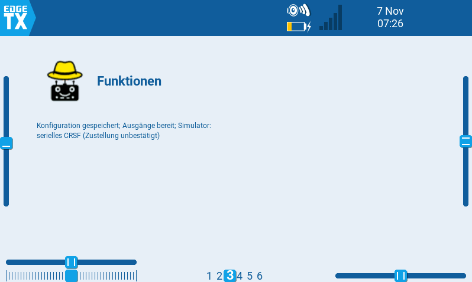
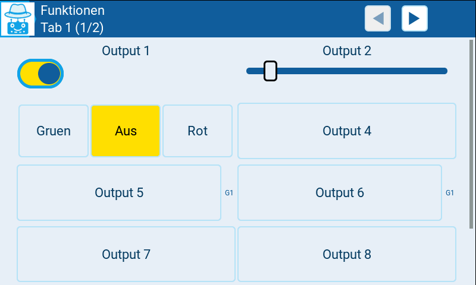
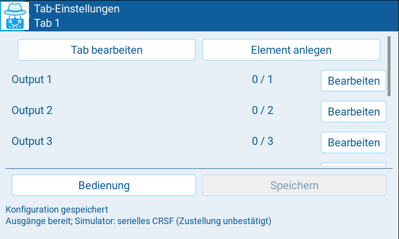
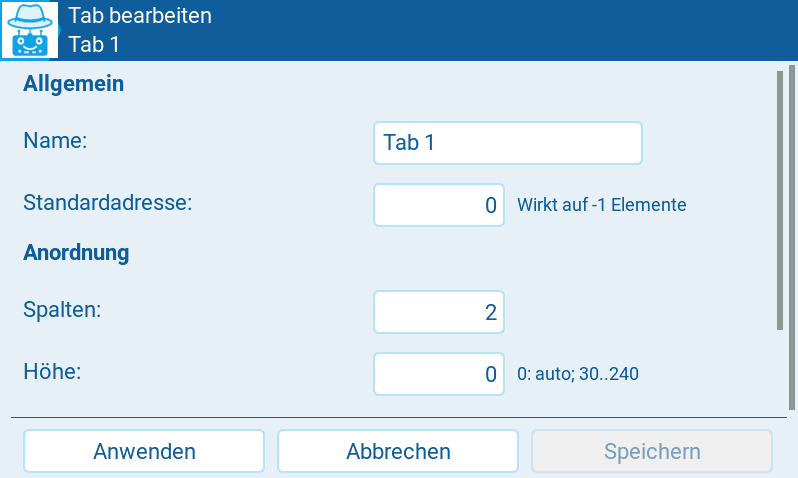
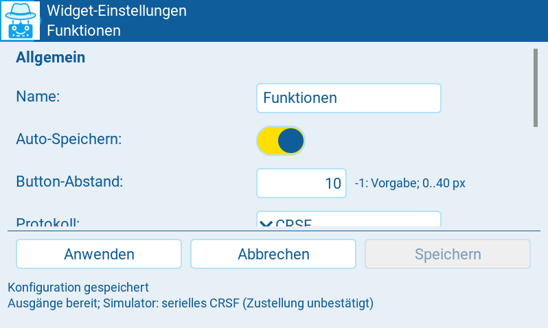
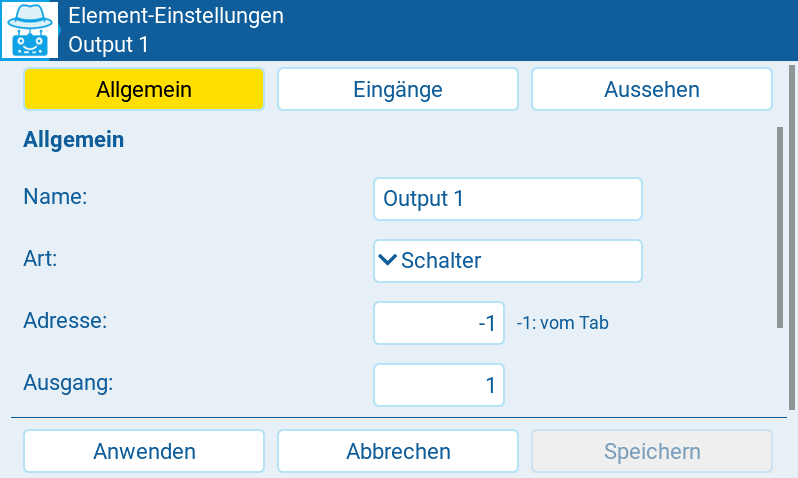
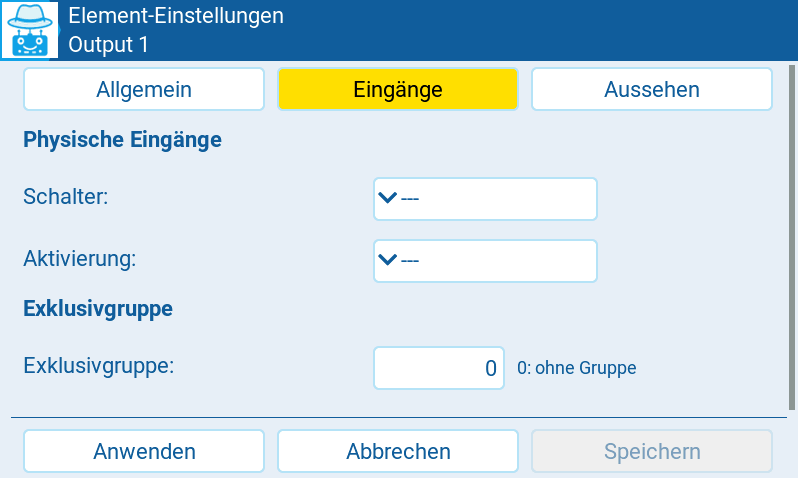
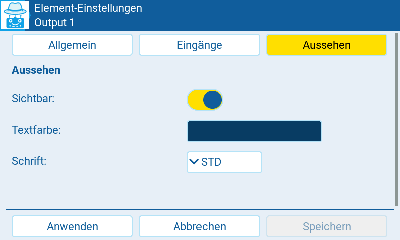

// SPDX-License-Identifier: GPL-3.0-or-later
// Copyright (C) 2026 Wilhelm Meier

= MultiSwitch NG

Neuimplementierung des LVGL-MultiSwitch-Widgets für EdgeTX 2.11.3 oder neuer
mit LVGL-Unterstützung. Die vorhandene Implementierung in `../lvglMultiSw`
wird nicht verändert. Ein Test auf dem Sender bzw. im EdgeTX-Simulator ist
vor dem Einsatz am Modell erforderlich.

== Sprache

Das Widget verwendet automatisch die EdgeTX-Menüsprache: Deutsch (`DE`)
oder Englisch (`EN`). Andere Sprachen oder ältere APIs ohne Sprachangabe
verwenden Englisch. Die Sprachausgabe-Einstellung ist dafür nicht maßgeblich.
Die Menüsprache wird nur einmal beim Start der gemeinsam genutzten
Widget-Instanz eines Modells gelesen, nicht bei Seitenwechseln oder im
Hintergrund. Eine spätere Änderung wird erst nach einem Neustart der
Lua-Umgebung, etwa durch Neustart von Sender bzw. Simulator, übernommen.

Beschriftungen, Einstellungsseiten, Hinweise und widgeteigene Status- und
Fehlermeldungen werden übersetzt. Namen vorhandener Widgets, Tabs und Elemente
bleiben unverändert; nur neu erzeugte Standardnamen verwenden die gewählte
Sprache. Konfigurationsformat, Kennungen und Protokolldaten bleiben
sprachunabhängig. Die Sprache wird nicht in der Konfiguration gespeichert.

Die englischen Texte sind zugleich Übersetzungsschlüssel und Rückfalltexte;
der deutsche Katalog liegt in `lang/de.lua`. Fehlende einzelne Übersetzungen
erscheinen Englisch. Eine fehlende oder fehlerhafte deutsche Katalogdatei
wird dagegen ausdrücklich als Startfehler angezeigt. Frühe Startfehler vor
der Sprachinitialisierung sowie native Lua-/Dateisystemmeldungen können
Englisch bleiben. Das separate Speicherdiagnosewerkzeug bleibt Englisch.
Die folgende Bedienungsbeschreibung verwendet die deutschen Beschriftungen
aus `lang/de.lua`, passend zu den Bildschirmfotos.

== Installation und Bedienung

Das Verzeichnis als `/WIDGETS/lvglMultiSwNG/` auf die SD-Karte kopieren.
Bei einem Update auch `i18n.lua`, das gesamte Verzeichnis `lang/` und alle
geänderten Widget-Module sowie `Logo_small_64_t.png`, `Logo_30_inv.png`,
`Logo_40_inv.png` und `Logo_56_inv.png` übertragen.
`tests/` wird auf dem Sender nicht benötigt. Das Widget heißt `MultiSw NG`.
Es gibt keine funktionalen Widget-Options.

Die erste Konfiguration enthält einen Tab mit acht rastenden Buttons,
Standardadresse 0 und Ausgängen 1 bis 8. Im normalen Widget-Fenster erscheinen
das farbige wimalopaan-Logo, der konfigurierte Widget-Name und bis zu zwei
Statuszeilen. Der Statusbereich wird dafür nach oben erweitert, ohne Logo
und Name zu überlagern. In flachen Widget-Fenstern passt nur eine Statuszeile;
in sehr flachen Fenstern haben Logo und Name Vorrang vor dem Status.
Die frühe Ladeanzeige bleibt einzeilig.
Die Bedienung, Konfiguration und vollständige Statusanzeige erfolgen im Vollbild.

.Widget-Ansicht mit farbigem Logo, Widget-Name und Statusanzeige.

Die automatische Elementhöhe füllt beim Standardlayout mit zwei Spalten
den sichtbaren Bedienbereich mit genau den acht Buttons. `Einstellungen` und
die Statusanzeige liegen darunter und werden durch Scrollen erreichbar.

.Beispiel einer Bedienseite mit Schalter, Schieberegler, 3-Positions-Tasten und Gruppenmarkierungen.

* Die Kopfzeile zeigt den aktiven Tab mit seiner Position, etwa `Licht (2/4)`.
  Die Vor-/Zurück-Buttons in der Kopfzeile wechseln zwischen Tabs; am Anfang
  bzw. Ende ist der jeweilige Button deaktiviert. Eine separate Reiterleiste
  im Bedienbereich entfällt. Auf Editor- und Konfigurationsseiten werden
  die Tab-Umschalter ausgeblendet.
  Nur die Bedienelemente des aktiven Tabs werden aufgebaut.
* Unter den Bedienelementen trennt eine Linie den Konfigurationsbereich ab.
  Standardmäßig ist dort nur `Einstellungen` sichtbar. Der Button blendet
  `Tab Einstellungen`, `Neuer Tab`, `Global` und `Speichern` ein; `Einstellungen ausblenden` klappt sie
  wieder ein. Nach Verlassen des Vollbilds ist der Bereich wieder geschlossen.
  Auf den Konfigurationsseiten ist
  `Speichern` weiterhin direkt erreichbar.
* `Neuer Tab` öffnet den Editor für einen neuen, zunächst leeren Tab.
  Als Standardadresse wird eine noch unbenutzte Adresse vorgeschlagen.
* `Tab Einstellungen` zeigt eine kompakte Elementliste mit Name,
  Adresse/Ausgang und `Bearbeiten`-Button nebeneinander in einer Zeile.
  `Tab bearbeiten` öffnet die Tab-Einstellungen, `Element anlegen` einen neuen Elemententwurf.
  In der Kopfzeile lässt sich wie auf der Bedienseite durch die Tabs blättern.
  Die beiden oberen Aktionen bleiben außerhalb der scrollenden Elementliste
  und sind gleich groß und spaltenweise mit `Bedienung` und `Speichern` unten ausgerichtet.
  Eine Trennlinie grenzt die oberen Aktionen von der Liste ab.
  Die unteren Aktionen stehen zunächst am sichtbaren unteren Rand.
  Der Statustext folgt darunter hinter einer weiteren Trennlinie und wird
  durch Scrollen der gesamten Seite erreichbar. Die Elementliste ist zusätzlich
  innerhalb ihres eigenen Bereichs scrollbar.
  `Tab löschen` befindet sich im Tab-Editor; `Element löschen` im Elementeditor.
  Der letzte Tab kann nicht gelöscht werden. Beim Löschen eines Tabs werden
  auch seine Elemente entfernt.
* Ein Element besitzt Name, Art, Adresse, Ausgang, Sichtbarkeit,
  Exklusivgruppe, Farben, Schrift, optionales Button-Bild und
  physische Schalter-/Quellenzuordnung. `Verschieben` im Elementeditor öffnet
  eine separate Verschiebeansicht mit Ziel-Tab, Adressvorschau und
  Bestätigung bzw. Abbruch. Der Item-Editor enthält keine Tab-Auswahl.
  Mit nur einem Tab ist `Verschieben` deaktiviert; bei neuen, noch nicht angewendeten
  Elementen sind Verschieben und Löschen nicht verfügbar.
  Abbrechen der Verschiebeansicht kehrt zum unveränderten Entwurf zurück.
  Bestätigen übernimmt den aktuellen Entwurf und die neue Tab-Zuordnung gemeinsam.
* Adresse `-1` bedeutet: Standardadresse des Tabs erben. Eine Änderung der
  Tab-Adresse wirkt auf alle erbenden Elemente. Eine explizite Adresse
  bleibt unverändert. Beim Verschieben eines erbenden Elements wird die
  Standardadresse des Ziel-Tabs wirksam.
* Kombinationen aus Adresse und Ausgang müssen über alle Tabs eindeutig
  sein, auch für unsichtbare Elemente. Konflikte werden beim Anwenden
  angezeigt; die bisherige Konfiguration bleibt aktiv.
* `Anwenden` prüft und bereitet einen Editorentwurf schrittweise vor.
  Erst nach erfolgreichem Abschluss wird die neue Konfiguration aktiviert.
  Währenddessen zeigt die Ansicht den Fortschritt und `Änderung abbrechen`;
  ein Abbruch lässt die bisherige Konfiguration und den Entwurf unverändert.
  `Abbrechen` verwirft den Entwurf. `Speichern` schreibt die angewendete Konfiguration.
  Beim Verlassen des Vollbilds wird das Speichern angeboten. Die Speicherung
  läuft auch nach Schließen des Vollbilds im Hintergrund weiter.
* Unter `Global` aktiviert `Auto-Speichern` das automatische Speichern.
  Die Vorgabe für neue Konfigurationen ist eingeschaltet. Bereits gespeicherte
  Einstellungen werden nicht geändert. Nach `Anwenden`, Hinzufügen, Löschen oder
  Verschieben werden Änderungen automatisch im Hintergrund gespeichert.
  Unangewendete Editorentwürfe und Schaltzustände werden nicht gespeichert.
  Weitere Änderungen während einer Speicherung werden anschließend
  nachgespeichert. Auch das Ausschalten von Auto-Speichern wird noch gespeichert.
  Bei aktivem Auto-Speichern entfällt die Speicherabfrage beim Schließen.
  Nach einem Speicherfehler bleibt die Änderung ungespeichert und der Fehler
  sichtbar; ein erneuter Versuch erfolgt über `Speichern` oder eine neue Änderung,
  nicht in einer unbegrenzten Wiederholungsschleife.

Die Fußzeile zeigt Konfigurations-/Speicherstatus und Betriebsstatus auf
zwei getrennten Zeilen. Eine laufende Speicherung verdeckt daher keine
ausstehende Abschaltung. Speicherfehler, Quellenfehler und Übertragungsfehler
werden unabhängig verwaltet: Ein erfolgreicher Vorgang löscht nur den
zugehörigen Fehler. Nicht verfügbare Schieberegler-Quellen setzen den Ausgang auf 0;
ihre Fehlermeldung verschwindet beim begrenzten Eingabepolling, sobald die
Quelle wieder gültige Werte liefert oder ihre Zuordnung deaktiviert wird.
Bei mehreren betroffenen Elementen nennt der Status zusätzlich deren Anzahl.

Tab-Spaltenzahl und Elementhöhe sind unabhängig einstellbar. Zusätzliche
Elemente erhalten automatisch einen freien Ausgang, nötigenfalls mit
expliziter anderer Adresse.
Die Vorgabe für die Elementhöhe ist `0`: automatische Berechnung für
acht Elemente anhand von Bildschirmgröße und Spaltenzahl, einschließlich
Zeilenabständen und Innenrändern. Zusätzliche Elemente werden gescrollt.
Manuelle Höhen von 30 bis 240 bleiben möglich und werden nicht automatisch
angepasst. Für vorhandene Tabs lässt sich die Automatik im Tab-Editor durch
Setzen von `Höhe` auf `0` aktivieren.

Unter `Global` lässt sich der `Button-Abstand` für alle Tabs einstellen.
Die Vorgabe `-1` behält die bisherigen, bildschirmabhängigen Abstände bei;
Werte von 0 bis 40 legen den horizontalen und vertikalen Abstand in Pixeln fest.
Die Elementbreite und automatische Höhe berücksichtigen diesen Abstand.
Bei einem eigenen Abstand beträgt die automatische Höhe mindestens 30 Pixel;
passen acht Elemente dadurch nicht mehr auf den Bildschirm, wird gescrollt.
Manuell eingestellte Elementhöhen bleiben unverändert. Die inneren Abstände
der 3-Positions-Tastengruppe und die Abstände auf den Einstellungsseiten
bleiben unverändert.

== Einstellungsseiten

Die Standard-Kopfzeile verwendet links das einfarbige wimalopaan-Logo als
Zurück-Symbol. Je nach Kopfzeilenhöhe wird die 30-, 40- oder 56-Pixel-Variante
verwendet, damit das Logo den verfügbaren Platz besser ausnutzt.
Alle drei Masken werden direkt aus dem farbigen 64-Pixel-Original abgeleitet,
nicht aus einer bereits verkleinerten Variante.
Die Navigation bleibt unverändert.

Die Kopfzeile nennt die jeweilige Einstellungsseite: `Widget-Einstellungen`,
`Tab bearbeiten`, `Element-Einstellungen` oder `Element verschieben`.
Beim Anlegen eines neuen Tabs heißt die Seite weiterhin `Tab-Einstellungen`.
Darunter steht der Name des Widgets, Tabs beziehungsweise Elements.
Die kurzen Beschriftungen der Navigationsbuttons bleiben unverändert.
Auf der Bedienseite werden weiterhin Widget-Name und aktiver Tab angezeigt.

Alle Formulare verwenden gleich hohe Eingabefelder mit einer festen
Beschriftungsspalte links. Kurze Hinweise, etwa zur geerbten Adresse,
zur Intervalleinheit, zur Höhe oder zur Exklusivgruppe, stehen kleiner
rechts neben dem Eingabefeld. Bei Bedarf werden sie umgebrochen und die
Zeilenhöhe angepasst. Allgemeine Protokollhinweise bleiben separate Absätze.
Überschriften gliedern die Einstellungen.
Im Tab- und Elementeditor stehen `Anwenden`, `Abbrechen` und `Speichern`
am sichtbaren unteren Rand. Der Statustext folgt darunter hinter einer
Trennlinie und ist durch Scrollen der gesamten Seite erreichbar.
In den globalen Widget-Einstellungen und in der Verschiebeansicht scrollt
nur der Formularbereich; Aktionen und zweizeilige Statusanzeige bleiben sichtbar.
`Speichern` schreibt weiterhin ausschließlich bereits angewendete Einstellungen.

.Elementliste eines Tabs mit Adresse und Ausgang sowie direktem Zugang zum Elementeditor.

.Tab-Editor mit Name, Standardadresse und Layout-Einstellungen.

Die globalen Einstellungen sind in `Allgemein` und einen protokollspezifischen
Bereich (`CRSF`, `S.Port WM` oder `S.Port ACW`) gegliedert,
die Tab-Einstellungen in `Allgemein`, `Anordnung` und `Verwaltung`.
Der Elementeditor hat drei Unterseiten: `Allgemein` für Name, Art, Adresse,
Ausgang und Verwaltungsaktionen; `Eingänge` für physische Zuordnungen,
Aktivierung und Exklusivgruppe; `Aussehen` für Sichtbarkeit, Farben,
Schrift und Bilder. Wechsel zwischen Unterseiten erhalten den gesamten Entwurf.

Unter CRSF wird `Farben jetzt senden` im globalen Editor sofort durch die Einstellung
`LED-Farben` aktiviert bzw. deaktiviert, ohne dass vorher `Anwenden` nötig ist.
Der Button sendet die aktuell angewendeten Elementfarben einmalig.
Die dauerhafte Einstellung und andere globale Editoränderungen bleiben
bis `Anwenden` unverändert.
Ist aktuell S.Port aktiv, muss zuerst CRSF angewendet werden.
Ein Wechsel der Protokollauswahl erhält den gesamten Entwurf und die
Einstellungen des jeweils anderen Protokolls, aktiviert aber erst mit `Anwenden`
den neuen Transport.

.Globale Widget-Einstellungen mit Auto-Speichern und Protokollauswahl.

Nur passende Felder werden angezeigt: `Schalter 2` bei `3-Positionen`, `Quelle`
bei Schiebereglern, Exklusivgruppen bei Schaltelementen und Bilder bei Buttons
bzw. Touch-Tastern. Ausgeblendete Eigenschaften bleiben im Entwurf erhalten;
ein Unterseiten- oder Typwechsel speichert nichts automatisch.
Bei `Schalter` entfällt `Farbe`, da der native EdgeTX-Schalter die Farben
des Sender-Themes verwendet. `Textfarbe` bleibt für seine Überschrift einstellbar.

.Elementeditor: Allgemeine Einstellungen wie Name, Art und Adresse.

.Elementeditor: Physische Eingänge, Aktivierung und Exklusivgruppe.

.Elementeditor: Sichtbarkeit, Elementfarbe und Textfarbe.

== Elemente und physische Bedienung

`Button` rastet ein, `Schalter` ist ein Ein/Aus-Schalter, `3-Positionen` verwendet
die Zustände Mitte = 0, rechts = 1, links = 2.
`3-Positionen` erscheint als Dreier-Tastengruppe mit hervorgehobener aktiver Position.
Im Elementeditor unter `Allgemein` legen `Text links` und `Text rechts` die beiden
äußeren Beschriftungen fest (je höchstens 32 Bytes). Diese Benutzertexte
werden unverändert gespeichert und nicht übersetzt oder durch `L`/`R` ersetzt.
Die mittlere Taste zeigt übersetzt `Aus`. Eine Überschrift über
der Gruppe entfällt; der Elementname bleibt für die Verwaltung erhalten.
Bei wenig Platz wird zunächst eine kleinere Schrift verwendet.
Alte Konfigurationen ohne die neuen Felder erhalten beim Laden passende
Standardtexte; nach dem Speichern bleiben auch diese sprachunabhängig erhalten.
Die Position wird direkt angewählt; erneutes Antippen derselben Taste ändert sie nicht.
Ist einer der beiden physischen Schalter zugeordnet, dient die Gruppe nur als Anzeige.
`Taster` ist nur während der Betätigung aktiv, `Schieberegler` liefert 0 bis 100 %.
Touch-Taster werden beim Seiten-/Tabwechsel, Neuaufbau und Verlassen des
Vollbilds zurückgesetzt.

Eine Schalterzuordnung deaktiviert die Touch-Bedienung des betreffenden
Schaltelements. Bei `3-Positionen` hat der erste Schalter Vorrang; der zweite aktiviert
Zustand 2. Negative Schalterkennungen werden unterstützt.
Eine Schieberegler-Quelle verwendet wie beim bisherigen Widget den positiven
Quellenbereich: 0 bis 1024 entsprechen 0 bis 100 %; negative Werte ergeben 0 %.
Quellenwerte werden begrenzt und auf ganze Prozent gerundet.
Eine fehlende Quelle wird angezeigt und setzt den Schieberegler auf 0 %.
Bei zugeordneter Quelle ist die Touch-Bedienung des Schiebereglers deaktiviert.

Ein Aktivierungsschalter sperrt bei inaktivem Zustand die Bedienung und
setzt den Ausgang zurück. Exklusivgruppen gelten tabübergreifend für
Schaltelemente; 0 bedeutet keine Gruppe. Physische Gruppenanforderungen
werden flankengesteuert verarbeitet: Bei gleichzeitig gehaltenen Schaltern
bleibt die zuletzt eingelesene Einschaltflanke maßgebend, ohne Oszillation.
Schieberegler nehmen nicht an Exklusivgruppen teil.
Sobald eine Gruppe mindestens zwei Schaltelemente enthält, steht rechts
an ihren sichtbaren Elementen eine kleine Markierung wie `G1`.
Dabei zählen auch Mitglieder anderer Tabs und ausgeblendete Schaltelemente,
nicht jedoch Schieberegler. Die Markierungen folgen der angewendeten Konfiguration;
Elementnamen und gespeicherte Beschriftungen bleiben unverändert.

Auch in inaktiven Tabs werden physische Eingänge verarbeitet und
Ausgangszustände übertragen. Pro Hintergrundschritt werden maximal acht
physische Zuordnungen eingelesen. Schaltzustände werden nicht gespeichert;
nach einem Neustart beginnen Touch-Elemente ausgeschaltet.

Mehrere Widget-Instanzen eines Modells teilen Konfiguration, Zustände und
Sender. Pro 10-ms-Zeitwert läuft die gemeinsame Verarbeitung nur einmal.
Ändert eine andere Ansicht die Konfiguration, kann ein bereits geöffneter
Editorentwurf nicht ungeprüft darübergeschrieben werden.

== CRSF

Referenz: https://github.com/wimalopaan/Electronics/blob/main/docs/protocols.adoc#crsf_sw

Verwendet werden `crossfireTelemetryPush(0x32, payload)`, Quelladresse `0xea`
und Realm `0xa1`. CRCs fügt EdgeTX hinzu.

* `Set4` (`0x07`) für eine Schaltadresse.
* `Set4M` (`0x09`) für mehrere Adressen, maximal 18 Adressen pro Paket.
  Größere Konfigurationen werden über mehrere Pakete verteilt.
* `Prop` (`0x02`) für Schieberegler, Ausgangsnummer im Paket 0 bis 7.
  Im Editor werden Ausgänge 1 bis 8 angezeigt.
* Optional `SetRGB` (`0x0a`) mit RGB444-Farben aus den Elementfarben.
  Aktivierung unter `Global`. Farben werden nach Konfigurationsänderungen
  und bei Wiederkehr von `RQly` erneut übertragen.

CRSF-Zieladresse und Wiederholintervall werden unter `Global` konfiguriert,
nicht über Widget-Options. Das Intervall hat die Einheit 10 ms;
Vorgabe 100 = 1 Sekunde. Änderungen werden unabhängig davon zeitnah gesendet.
Je Hintergrundschritt wird höchstens ein Paket an EdgeTX übergeben.
Schaltzustände, proportionale Werte und Farben werden fair abgearbeitet.
Bei voller Sendewarteschlange bleiben Anforderungen erhalten; der Status
meldet den Engpass. Bei sehr vielen Ausgängen bestimmt die verfügbare
CRSF-Bandbreite die tatsächliche Wiederholrate.

Auf dem Sender muss für die native CRSF-Schnittstelle ein internes oder
externes HF-Modul auf CRSF/ELRS eingestellt sein. Ohne aktives CRSF-Protokoll
liefert EdgeTX `nil`; das Widget meldet dann `CRSF inaktiv: CRSF-/ELRS-HF-Modul wählen`, nicht einen
vollen Sendepuffer. Ein Rückgabewert `false` bedeutet dagegen, dass EdgeTX
das Paket nicht annehmen konnte.

Der Simulator wird wie beim alten Widget anhand der Endung `-simu` der
Radiokennung von `getVersion()` erkannt. Hier wird die native CRSF-Schnittstelle
nicht verwendet: Vollständige CRSF-Command-Frames gehen über `serialWrite`
an die serielle Simulatorausgabe. Die Frames beginnen mit `0xc8` und enthalten
sowohl die Command-CRC (`0xba`) als auch die Frame-CRC (`0xd5`).
Die native globale CRSF-Funktion wird dabei nicht überschrieben.
Die serielle Ausgabe des Simulators muss für einen angeschlossenen Empfänger
separat eingerichtet werden. Eine HF-Modulauswahl allein genügt dafür nicht.
`serialWrite` liefert keine Zustellbestätigung; der Status zeigt daher
`Simulator: serielles CRSF (Zustellung unbestätigt)`.
Fehlt die API, wird ein Fehler angezeigt und der Ausgangszustand bleibt
zur Übertragung vorgemerkt. Ein serieller Telemetrieempfang ist nicht enthalten.

Schieberegler werden im Schaltzustandswort bei einem Wert größer 0 eingeschaltet.
Nach Schaltzustandspaketen werden die PWM-Werte erneut übertragen.
Entfernte oder umadressierte Ausgänge erhalten explizit einen Nullzustand;
entfernte Schieberegler zusätzlich `Prop` mit 0 %.

== S.Port WM

Unter `Global` wählt `Protokoll` zwischen `CRSF`, `S.Port WM`,
`S.Port ACW 1.5` und `S.Port ACW 1.4`.
Pro Modell ist genau ein Ausgabeprotokoll aktiv; alle Tabs verwenden es.
CRSF bleibt die Vorgabe, auch für bestehende NG-Konfigurationsdateien.

S.Port-WM übernimmt das Telegrammformat aus `../lvglMultiSw/sport.lua`:

----
sportTelemetryPush(physicalId, 0x31, appId * 256 + address, state)
----

`Physical-ID` ist von 0 bis 27 einstellbar, Vorgabe 0.
`App-ID` bezeichnet das obere Byte der Data-ID, von 0 bis 255;
Vorgabe 81 (`0x51`). Das untere Byte ist die effektive Element-/Tab-Adresse
von 0 bis 255. Je Adresse enthält `state` acht Ausgänge mit jeweils zwei Bits:
Ausgang 1 belegt Bits 0/1, Ausgang 8 Bits 14/15.
Die Zustände 0, 1 und 2 werden unverändert übertragen.

Unterstützt werden `Button`, `Schalter`, `3-Positionen` und `Taster`, einschließlich
physischer Schalter, Aktivierung und tabübergreifender Exklusivgruppen.
Schieberegler und LED-Farbübertragung sind im WM-Format nicht enthalten.
Die Typauswahl enthält daher keine Schieberegler; vorhandene Schieberegler verhindern
das Anwenden einer S.Port-Konfiguration mit einer Fehlermeldung.
Die bisherige Konfiguration bleibt dabei aktiv.
CRSF-Farbeinstellungen bleiben gespeichert, sind unter S.Port aber ohne Wirkung.
Die Farben der Bedienoberfläche sind weiterhin frei einstellbar.

Änderungen werden zeitnah übertragen; das gemeinsame `Intervall` bestimmt
die Wiederholung in Einheiten von 10 ms. Pro Hintergrundschritt werden
höchstens acht Adressen geprüft und höchstens ein Telegramm gesendet.
Ein rotierender Cursor sorgt für faire Verarbeitung aller Adressen.
Er wird auch nach einem abgelehnten normalen Sendeversuch weitergestellt;
eine dauerhaft blockierte Adresse hält dadurch andere normale Ausgänge
nicht auf. Der abgelehnte Eintrag bleibt ausstehend und wird beim nächsten
Umlauf mit seinem aktuellen Wert erneut versucht. Sein Fehler bleibt
sichtbar, auch wenn Telegramme anderer Adressen angenommen werden.
Notwendige Abschaltungen der aktuellen Protokollvariante behalten dagegen
Vorrang und dürfen nicht von neuen Einschaltbefehlen überholt werden.
Nur der Rückgabewert `true` bestätigt die Annahme durch EdgeTX; fehlgeschlagene
Versuche bleiben ausstehend und werden mit einem Statusfehler erneut versucht.
Eine Empfangsbestätigung des Schaltmoduls ist damit nicht verbunden.

Auf dem Sender ist ein zu S.Port kompatibles HF-Modul erforderlich.
Das angesprochene Gerät darf nicht bereits als Telemetriesensor in EdgeTX
registriert sein: Laut Vorlage kann EdgeTX andernfalls die Telegramme blockieren.
Die Statusmeldung nennt deshalb HF-Konfiguration, Sendewarteschlange und
Sensorkonflikte als mögliche Ursachen einer abgelehnten Übertragung.
S.Port verwendet auch im Simulator die native `sportTelemetryPush`-API;
eine eigene serielle S.Port-Ausgabe ist nicht enthalten.

Entfernte Adressen und Änderungen von Physical-ID oder App-ID erhalten
Nulltelegramme an die alte Adresse beziehungsweise mit den alten IDs.
Abschaltungen sind nur nötig, wenn zuvor ein Einschaltzustand vom Transport
angenommen wurde und noch kein Nullzustand angenommen wurde. Nie erfolgreich
angesprochene oder bereits ausgeschaltete Ausgänge erzeugen keine weiteren
Abschaltversuche. Das verhindert dauerhafte Warnungen beim bloßen Testen
der Protokollauswahl ohne passende HF-Modulauswahl.
Diese Information bleibt bei unveränderter Zuordnung über
Konfigurationsänderungen erhalten; erst beim Aktivieren der neuen Laufzeit
wird entschieden, welche Abschaltungen noch nötig sind.
Beim Protokollwechsel werden alte Ausgänge über ihren ursprünglichen
Transport ausgeschaltet; ausstehende Telegramme bleiben auch über weitere
Konfigurationsänderungen erhalten. Ist der alte Transport nicht mehr erreichbar,
zeigt der Status `Alte Abschaltung ausstehend`; das neue Protokoll wird trotzdem
weiter bedient. Insgesamt bleibt es bei höchstens einem Telegramm pro Tick.
Für eine sichere Abschaltung das HF-Modul erst nach erfolgreicher Übertragung
der alten Nulltelegramme umstellen. Ein nicht mehr erreichbarer Empfänger
kann durch das Widget nicht zuverlässig ausgeschaltet werden.

== S.Port ACW 1.5 und 1.4

Die ACW-Varianten übernehmen das Packing der Vorlage:

----
value = type * 0x1000000 + options * 0x10000 + number * 256 + pwm
sportTelemetryPush(0x1b, 0x10, dataId, value)
----

Die Physical-ID ist fest `0x1b` (27), die Frame-ID `0x10`.
Die Data-ID ist `0xac00` für ACW 1.5 und `0xfa07` für ACW 1.4.
Die konfigurierbaren WM-IDs sind bei ACW ohne Wirkung und bleiben für einen
späteren Wechsel zurück zu WM erhalten.

Jedes Element besitzt unter `Allgemein` einen Bereich `ACW-Ausgang`:

* `ACW-Typ` (`sportType`): Typbyte, Vorgabe 1.
* `ACW-Optionen` (`sportOptions`): Optionsbyte, Vorgabe 0.
* `Einschalt-PWM` (`sportPwmOn`): Einschaltwert, Vorgabe 255.

Alle drei Werte liegen zwischen 0 und 255 und werden unverändert übertragen.
Typ und Optionen sind Rohwerte; ihre Bedeutung richtet sich nach dem
angeschlossenen Decoder. PWM ist ein 8-Bit-Wert, kein Prozentwert.
Ausgeschaltet wird PWM 0 gesendet, eingeschaltet der konfigurierte Einschaltwert.

Die Schaltnummer ist die effektive Adresse mal 8 plus Ausgang (1 bis 8).
Sie muss in ein Byte passen und liegt daher zwischen 1 und 255.
Adresse 31/Ausgang 7 ist die letzte mögliche Kombination;
Adresse 31/Ausgang 8 und höhere effektive Adressen werden beim Laden
oder Anwenden ausdrücklich abgewiesen, nicht durch Maskieren verändert.
Die automatische Ausgangsvergabe berücksichtigt diese Grenze.

Unterstützt werden `Button`, `Schalter` und `Taster`, einschließlich
physischer Schalter, Aktivierung und Exklusivgruppen. Die Auswahl
`Taster` bleibt intern Elementart 4. `3-Positionen`, Schieberegler und LED-Farbübertragung
sind für ACW nicht umgesetzt; entsprechende Elementarten verhindern das
Anwenden der Konfiguration. Zwei aktive 3-Positions-Zustände werden nicht
stillschweigend auf denselben Einschaltwert reduziert.

Je Element wird ein eigenes Telegramm gesendet. Wiederholintervall,
begrenzter Scheduler, Fehlerbehandlung und native Simulator-API entsprechen
S.Port-WM: höchstens acht Elementprüfungen und ein Telegramm pro Tick.
Beim Löschen oder Umadressieren eines Elements, Ändern von Typ/Optionen
oder Wechseln des Protokolls wird zunächst das alte ACW-Telegramm mit PWM 0
eingereiht. Es behält seine ursprüngliche Data-ID, Schaltnummer, Typ und Optionen.
Jede Protokollvariante besitzt eine eigene Abschaltwarteschlange.
Blockierte alte WM- oder ACW-Telegramme halten weder die neue Variante
noch deren eigene Abschaltungen auf.
Auch Wechsel zwischen ACW 1.5, ACW 1.4 und WM bereiten Konfiguration und
Abschaltungen schrittweise vor. Bereits angewendete Laufzeitwerte bleiben
bei unveränderten Zuordnungen erhalten; PWM-Änderungen verwenden den neuen
Einschaltwert.

SHM, Telemetrieaktionen, Setzen virtueller Eingänge/Schalter
und Migration der Konfiguration des alten Widgets sind noch nicht enthalten.

== Speicherdiagnose auf dem Sender

`tools/swngmem.lua` ist ein separates Diagnose-Tool, insbesondere für
Messungen auf dem TX16S MK3. Die Datei nach `/SCRIPTS/TOOLS/swngmem.lua`
kopieren und im Tools-Menü des Senders starten. Die Widget-Module müssen
unter `/WIDGETS/lvglMultiSwNG/` installiert sein.
Nur am Boden und mit ausgeschalteten HF-Modulen messen.

Mit dem Drehgeber wird das Profil gewählt, mit `ENTER` ein einzelner
Messlauf gestartet. `EXIT` bricht einen laufenden Versuch ab; erneut
`EXIT` schließt das Tool. Zunächst die Profile mit 8 Elementen verwenden,
danach schrittweise 32, 64 und 128 testen. 256 ist ein weiteres, manuell
auszuwählendes Profil; ACW verwendet wegen seines Nummernbereichs 255.
Es gibt Profile für CRSF-Buttons, CRSF-Schieberegler, WM und beide ACW-Varianten.
Je acht Elemente wird ein Tab erzeugt. Das zusätzliche Profil `Empty tabs`
misst 8 bis 256 leere Tabs unabhängig von der Elementanzahl.

Das Tool verwendet ausschließlich synthetische Daten im RAM. Es verändert
keine Modellkonfiguration, sendet keine CRSF-/S.Port-Telegramme und ruft
keine serielle Ausgabe auf. Die tatsächlichen Widget-Module werden geladen,
je Durchlauf höchstens ein Modul oder ein Konfigurationsdatensatz verarbeitet.
Gemessen werden zwei unabhängig aufgebaute, dekodierte Konfigurationen,
eine aktive Laufzeit und die gleichzeitig vorbereitete Folgelaufzeit.
Die Garbage Collection wird an den Messpunkten gezielt ausgeführt.

Ergebnisse werden an `/LOGS/swngmem.csv` angehängt. Vorhandene Ergebnisse
bleiben erhalten. Die CSV enthält Sender/Firmware, Profilgröße, Lua-Belegung
vor dem Laden der Module, Modul-Baseline, Belegung mit zwei Konfigurationen,
aktive Laufzeit, parallele Vorbereitung, beobachtete Spitze und kleinsten
verfügbaren Heap. Alle Speicherwerte sind in KiB angegeben.
Die Differenzen zur jeweiligen Baseline zeigen den zusätzlichen Datenbedarf.
Abbrüche und Fehler werden ausdrücklich markiert; nicht erreichte Messpunkte
bleiben leer. Schreib-/Schließfehler der CSV werden auf dem Bildschirm angezeigt.

Die Heap-Reserve beträgt 25 Prozent des zu Laufbeginn verfügbaren Heaps,
mindestens 128 KiB. Wird diese Reserve erreicht, wird der Versuch abgebrochen
und seine Testkonfiguration freigegeben. Das ist eine Sicherheitsmarge für
die Diagnose, keine neue Konfigurationsgrenze. Eine einzelne große Allokation
kann zwischen zwei Messungen dennoch scheitern.

Die Werte beschreiben den Lua-Heap samt Diagnose-/Modul-Overhead und den
zusätzlichen Datenstrukturen. Andere Lua-Skripte können die Baseline beeinflussen.
Native LVGL-Objekte werden nicht erzeugt; Dateipuffer, Parser-Temporärdaten,
Grafiken und weitere Firmware-Allokationen sind nicht vollständig abgebildet.
Die beobachtete Spitze wird zwischen Verarbeitungsschritten gemessen,
nicht innerhalb jeder Allokation. Die Messungen sind daher die Grundlage
für weitere Tests auf dem Sender, nicht allein der Nachweis einer sicheren
maximalen Widget-Größe. Simulatorwerte ersetzen diese Hardwaremessung nicht.

== Konfigurationsdateien

Je Modell werden im Widget-Verzeichnis zwei wechselnde Dateien verwendet:
`model_<Modellkennung als Hex>.a.lua` und `.b.lua`.
Die Modellkennung ist `model.getInfo().filename`, falls vorhanden,
sonst der Modellname. Bei Verwendung des Modellnamens führt Umbenennen
zu einem anderen Dateipaar.
Die bisherige MultiSwitch-Konfiguration wird weder geladen noch überschrieben.

Jede Datei ist eine gültige Lua-Datei mit `return {`, einer Liste flacher
Datensätze und abschließendem `}`. Die Datensätze haben `kind="config"`,
`kind="tab"` oder `kind="control"`. Der Header steht zuerst, danach Tabs,
danach Elemente. Alle Schemafelder müssen vorhanden sein, mit diesen Ausnahmen:
Ältere Dateien ohne `autoSave` im Header werden als `autoSave=0` geladen.
Ein fehlendes Headerfeld `buttonSpacing` wird mit `-1` (bisherige Abstände) ergänzt.
Fehlende Headerfelder `protocol`, `sportPhysicalId` und `sportAppId` werden
mit 0 (CRSF), 0 und 81 ergänzt. `protocol=1` wählt S.Port-WM.
`protocol=2` wählt ACW 1.5, `protocol=3` ACW 1.4.
Fehlende Elementfelder `sportType`, `sportOptions` und `sportPwmOn` werden
mit 1, 0 und 255 ergänzt. Die Felder bleiben auch bei CRSF und WM gespeichert,
wirken aber nur bei ACW.
`version` beschreibt das Format, `generation` den Speicherstand.
Die Dateien enthalten ausschließlich Konfiguration, keine Laufzeitzustände.

Beim manuellen Bearbeiten:

* Pro Datensatz genau eine Zeile mit abschließendem Komma verwenden.
* Zeichenketten mit doppelten Anführungszeichen schreiben; nur skalare
  Literale verwenden, keine Funktionen, Referenzen oder weiteren Tabellen.
* Tab- und Element-IDs müssen jeweils eindeutig sein. Elemente verweisen
  mit `tab` auf eine zuvor definierte Tab-ID.
* Eine Datensatzzeile darf höchstens 2048 Bytes haben.
* Der vollständige gültige Speicherstand mit der höchsten `generation`
  wird geladen. Beim manuellen Ändern deshalb die Generation der bearbeiteten
  Datei erhöhen oder beide Dateien konsistent bearbeiten.

Module werden einzeln geladen. Die Konfigurationsdateien werden nicht als
Ganzes mit `loadfile` ausgeführt: Der Loader liest maximal 512 Bytes oder
verarbeitet einen Datensatz pro Hintergrundschritt. Nur der kleine,
vorab auf Literale eingeschränkte Datensatz wird einzeln kompiliert und
validiert. Damit sind sowohl Datei-I/O als auch das Verknüpfen der Elemente
über mehrere Aufrufe verteilt.

Anschließend bereitet eine Zustandsmaschine die Laufzeit vor:
`header`, `tabs`, `controls`, `sender`, `pending-off`, `retire-switches`,
`retire-sliders`, `complete`. Jeder Hintergrundschritt verarbeitet höchstens
einen Datensatz, eine Sender-Zuordnung oder eine ausstehende Abschaltung.
Dabei entstehen auch die Indizes für Tabs, Elemente, Adressen und
Exklusivgruppen; spätere Zugriffe benötigen keine vollständigen Suchläufe.
Erst am Ende werden die vorbereiteten Tabellen gemeinsam aktiviert.
Während einer Konfigurationsänderung laufen die bisherigen physischen
Eingänge und Ausgänge des bisherigen Protokolls weiter. Unveränderte Zuordnungen behalten ihre
aktuellen Werte und Schaltflanken, auch wenn diese sich während der
Vorbereitung ändern. Fehler und Abbruch lassen die bisherige Laufzeit aktiv.
Weitere Konfigurationsänderungen sind während der Vorbereitung gesperrt;
Auto-Speichern und angeforderte Speicherungen warten auf deren erfolgreichen Abschluss.

Auch der UI-Aufbau besitzt eine eigene Zustandsmaschine und läuft nur in
`refresh()`: höchstens vier einfache Objektdefinitionen pro Aufruf,
einschließlich verschachtelter Labels und Schieberegler. Reine Zustandswechsel
laufen im gleichen Refresh weiter; spätestens nach 16 Zustandsmaschinenschritten
wird unterbrochen. Seitenrahmen und Bilder werden jeweils allein in einem
Refresh erzeugt, damit sie nicht mit weiteren Konstruktoraufrufen zusammenfallen.
Beim Verschieben wird weiterhin höchstens ein Ziel-Tab pro Schritt vorbereitet.
Laufzeitvorbereitung und Datei-I/O behalten ihre bisherigen Schrittgrenzen.
Eine Fortschrittsanzeige
bleibt bis zur fertigen Ansicht sichtbar; teilweise aufgebaute und veraltete
Bedienelemente sind gesperrt. Seitenwechsel und Konfigurationsänderungen
verwerfen einen veralteten Aufbau. Die Aktualisierung rastender Buttons
prüft höchstens acht Elemente des aktiven Tabs pro Refresh.
CRSF durchsucht pro Schritt nur begrenzte Ausschnitte seiner Warteschlangen;
Neuübertragungen nach Wiederverbindung benötigen keine vollständigen Schleifen.

Damit wachsen die Lua-Schleifen eines einzelnen Aufrufs nicht mit der
gesamten Konfiguration. Eine absolute CPU-Limit-Garantie ergibt sich daraus
jedoch nicht: Modulkompilierung, einzelne Dateioperationen sowie das native
Erzeugen oder Löschen von LVGL-Objekten lassen sich innerhalb ihres Aufrufs
nicht unterbrechen. Insbesondere Bilddateien und große vorhandene Ansichten
müssen auf dem jeweiligen Sender geprüft werden.

Beim Speichern wird ein unveränderlicher Konfigurationsstand datensatzweise
in den jeweils anderen Slot geschrieben. Anschließend wird die Datei
schrittweise zurückgelesen und inhaltlich mit diesem Stand verglichen.
Erst danach meldet das Widget Erfolg. Weitere Änderungen während des
Speicherns bleiben als ungespeichert markiert.
Schreibfehler und unvollständige Dateien werden angezeigt. Der andere,
zuletzt vollständig gespeicherte Slot bleibt erhalten.
Ein vorhandener beschädigter Slot führt bei erfolgreicher Wiederherstellung
zu einem Hinweis. Sind beide lesbaren Dateien ungültig, stoppt das Laden;
`Erneut laden` oder ein ausdrücklich bestätigter Neustart mit
Standardkonfiguration sind möglich. Fehlende Slots werden anhand des
Fehlercodes oder der EdgeTX-Funktion `fstat` erkannt und sind kein
Wiederherstellungsfehler. Fehlen beide Dateien, startet die Standardkonfiguration.
Können beide Dateien aus einem anderen Grund nicht geöffnet werden, stoppt
das Laden mit den Dateifehlern. Vorhandene, nicht lesbare Konfigurationen
werden nicht durch Auto-Speichern überschrieben; neue Standardwerte müssen
ausdrücklich über `Standardkonfiguration anlegen` bestätigt werden.
Bei aktivem Auto-Speichern wird auch die neu erzeugte Startkonfiguration
automatisch gespeichert und geprüft. Ohne Auto-Speichern bleibt sie bis `Speichern`
oder zur Speicherbestätigung beim Verlassen des Vollbilds ungespeichert.

== Entwicklung

Die Module `config.lua`, `storage.lua`, `outputs.lua`, `crsf.lua`, `sport.lua`,
`runtime.lua`, `app.lua` und `ui.lua` trennen Datenmodell, inkrementelles I/O,
gemeinsame Ausgangszustände/Abschaltungen, Protokolle, schrittweise
Laufzeitvorbereitung, gemeinsame Verarbeitung und ansichtsspezifische
LVGL-Darstellung. Bei einem Update alle Lua-Module auf den Sender bzw.
in das Simulatorverzeichnis kopieren, einschließlich der neuen
`outputs.lua` und `sport.lua`.

Die lokalen Tests benötigen Lua 5.3 oder neuer:

----
lua tests/run.lua
----

Die Tests bilden die EdgeTX-I/O-Aufrufe inklusive rückgabewertlosem
`io.close` nach. Sie ersetzen keinen realen LVGL-/Sender-/Empfängertest.
