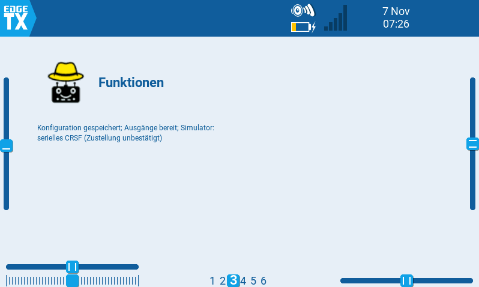
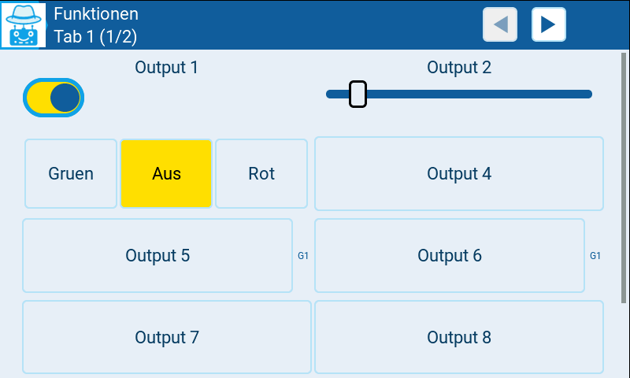
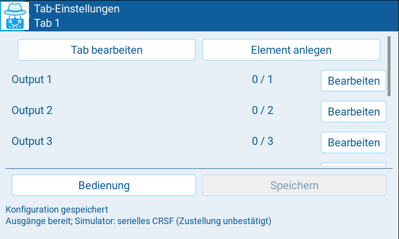
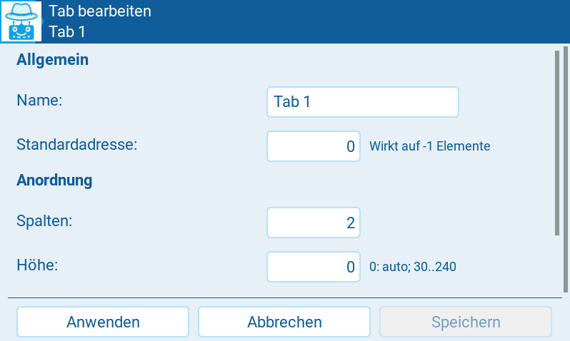
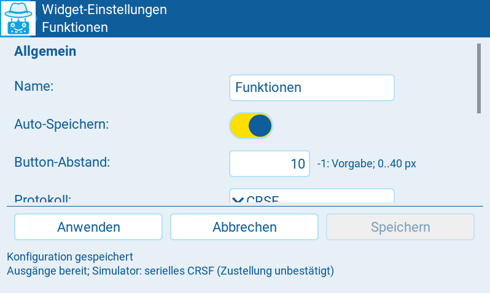
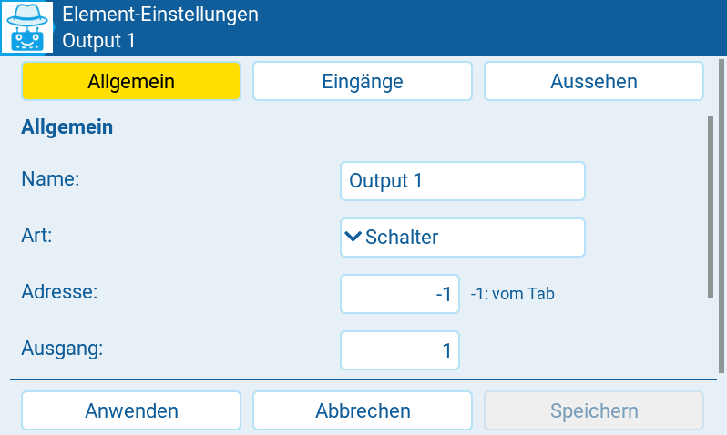
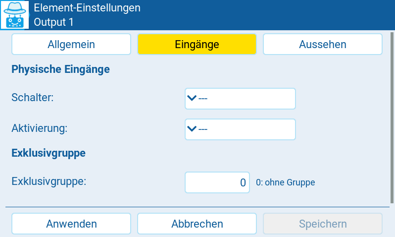
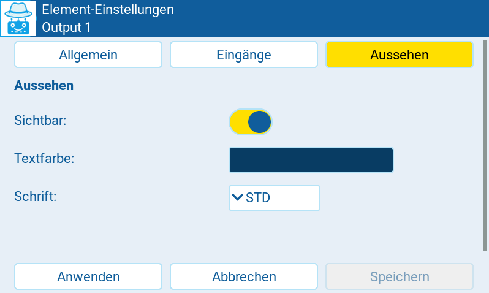

// SPDX-License-Identifier: GPL-3.0-or-later
// Copyright (C) 2026 Wilhelm Meier

= MultiSwitch NG

link:README.adoc[Deutsch] | *English*

A new implementation of the LVGL MultiSwitch widget for EdgeTX 2.11.3 or later
with LVGL support. The existing implementation in `../lvglMultiSw`
is not modified. Test the widget on your radio or in the EdgeTX simulator
before using it with a model.

== Language

The widget automatically uses the EdgeTX menu language: German (`DE`)
or English (`EN`). Other languages, or older APIs without language information,
fall back to English. The voice language setting does not determine the UI language.
The menu language is read only once when the shared widget instance for a model
starts, not when changing pages or during background processing.
Subsequent language changes take effect only after restarting the Lua environment,
for example by restarting the radio or simulator.

Labels, settings pages, explanations and widget-generated status and error messages
are translated. Existing widget, tab and control names remain unchanged;
only newly generated default names use the selected language.
The configuration format, identifiers and protocol data are language-independent.
The language is not stored in the configuration.

English strings serve as both translation keys and fallback text.
The German catalog is in `lang/de.lua`. Missing individual translations
fall back to English. A missing or invalid German catalog file, however,
is explicitly reported as a startup error. Early startup errors before language
initialization and native Lua or filesystem messages may remain in English.
The separate memory diagnostic tool remains in English.
This documentation uses the English UI labels; the screenshots show the German UI.

== Installation and operation

Copy the directory to `/WIDGETS/lvglMultiSwNG/` on the SD card.
When updating, also copy `i18n.lua`, the entire `lang/` directory,
all modified widget modules, and `Logo_small_64_t.png`, `Logo_30_inv.png`,
`Logo_40_inv.png` and `Logo_56_inv.png`.
The `tests/` directory is not required on the radio. The widget is named `MultiSw NG`.
There are no functional widget options.

The initial configuration contains one tab with eight latching buttons,
default address 0 and outputs 1 through 8. In the normal widget window,
the color wimalopaan logo, the configured widget name and up to two status lines
are displayed. The status area extends upwards without overlapping the logo
or name. Short widget windows display only one status line; very short windows
give priority to the logo and name over the status.
The early loading indicator remains a single line.
Operation, configuration and the complete status display are available in fullscreen.

.Widget view with the color logo, widget name and status display.

With the default two-column layout, automatic control height fills the visible
operating area with exactly eight buttons. `Setup` and the status display
are below them and can be reached by scrolling.

.Operating page with a toggle, slider, three-position buttons and group markers.

* The header shows the active tab and its position, for example `Lights (2/4)`.
  Previous and next buttons in the header switch between tabs.
  The corresponding button is disabled at the beginning or end.
  There is no separate tab bar in the operating area.
  Tab navigation is available on the operating page and the tab control list,
  but not on editor or move pages.
  Only the controls of the active tab are constructed.
* A separator below the controls marks the configuration area.
  Initially, only `Setup` is visible. It reveals `Tab settings`, `New tab`,
  `Global` and `Save`; `Hide setup` collapses the area again.
  The area is collapsed again after leaving fullscreen.
  `Save` remains directly accessible on configuration pages.
* `New tab` opens an editor for a new, initially empty tab.
  An unused address is suggested as its default address.
* `Tab settings` shows a compact control list with the name,
  address/output and an `Edit` button side by side in each row.
  `Edit tab` opens the tab editor; `Add control` opens a new control draft.
  The header lets you browse tabs just as on the operating page.
  The two upper actions are outside the scrolling control list.
  They have the same sizes and horizontal positions as `Control` and `Save` below.
  A separator divides the upper actions from the list.
  The lower actions initially sit at the bottom of the visible page.
  Status text follows below another separator and can be reached by scrolling
  the entire page. The control list also scrolls within its own area.
  `Delete tab` is in the tab editor; `Delete control` is in the control editor.
  The last tab cannot be deleted. Deleting a tab also deletes its controls.
* Each control has a name, type, address, output, visibility,
  exclusive group, colors, font, optional button image,
  and physical switch/source assignments.
  `Move` in the control editor opens a separate page with the target tab,
  an address preview, and actions to confirm or cancel.
  The control editor itself has no tab selector.
  With only one tab, `Move` is disabled. Moving and deleting are unavailable
  for new controls that have not yet been applied.
  Cancelling the move page returns to the unchanged draft.
  Confirming applies the current draft and its new tab assignment together.
* Address `-1` means inheriting the tab's default address.
  Changing the tab address affects all inheriting controls.
  Explicit control addresses remain unchanged.
  Moving an inheriting control makes the target tab's default address effective.
* Address/output combinations must be unique across all tabs,
  including invisible controls. Conflicts are reported when applying changes;
  the previous configuration remains active.
* `Apply` validates and prepares an editor draft incrementally.
  The new configuration becomes active only after successful completion.
  During preparation, the view displays progress and `Cancel update`.
  Cancelling leaves the previous configuration and the draft unchanged.
  `Cancel` discards the draft. `Save` writes the applied configuration.
  When leaving fullscreen, the widget offers to save.
  Saving continues in the background after fullscreen has closed.
* Under `Global`, `Auto-Save` enables automatic saving.
  It is enabled by default for new configurations; existing saved settings
  are not changed. Applied changes, additions, deletions and moves
  are saved automatically in the background.
  Unapplied editor drafts and switch states are not saved.
  Changes made during a save are saved afterwards.
  Disabling Auto-Save is itself still saved.
  With Auto-Save enabled, no save confirmation is needed when closing fullscreen.
  After a save failure, the change remains unsaved and the error remains visible.
  Retry using `Save` or by making another change;
  the widget does not retry in an unlimited loop.

The footer displays configuration/storage status and operating status
on two separate lines. An ongoing save therefore does not hide a pending shutdown.
Storage errors, source errors and transmission errors are managed independently:
a successful operation clears only its corresponding error.
Unavailable slider sources set the output to 0.
Their error messages disappear during bounded input polling once the source
becomes valid again or its assignment is disabled.
If several controls are affected, the status also reports their number.

Tab column count and control height can be configured independently.
Additional controls automatically receive a free output,
using an explicit different address if necessary.
The default control height is `0`: automatically fit eight controls according
to screen size and column count, including row spacing and internal margins.
Additional controls require scrolling.
Manual heights from 30 to 240 remain available and are not adjusted automatically.
For existing tabs, enable automatic height by setting `Height` to `0`
in the tab editor.

Under `Global`, `Button spacing` configures spacing for all tabs.
The default `-1` preserves the previous screen-dependent spacing.
Values from 0 to 40 specify horizontal and vertical spacing in pixels.
Control width and automatic height account for this spacing.
With custom spacing, automatic height is at least 30 pixels.
If eight controls no longer fit on the screen, the page scrolls.
Manual control heights remain unchanged.
Spacing inside the three-position button group and on settings pages
is unaffected.

== Settings pages

The standard header uses the monochrome wimalopaan logo on the left as its back icon.
Depending on header height, it uses the 30-, 40- or 56-pixel version
to make better use of the available space.
All three masks are derived directly from the color 64-pixel original,
not from an already downscaled version.
Navigation remains unchanged.

The header identifies the current settings page: `Global widget settings`,
`Edit tab`, `Control settings` or `Move control to another tab`.
When creating a new tab, the title remains `Tab settings`.
The widget, tab or control name appears below it.
The short navigation button labels remain unchanged.
The operating page still shows the widget name and active tab.

All forms use input fields of the same basic height and a fixed label column
on the left. Short explanations, such as those for inherited addresses,
interval units, height or exclusive groups, appear in a smaller font
to the right of the input. They wrap as needed, with row height adjusted accordingly.
General protocol explanations remain separate paragraphs.
Headings divide the settings into sections.
In global widget settings and the tab and control editors,
`Apply`, `Cancel` and `Save` sit at the bottom of the visible page.
Status text follows below a separator and can be reached by scrolling
the entire page.
On the move page, only the form area scrolls;
actions and the two-line status display remain visible.
`Save` still writes only settings that have already been applied.

.Tab control list with address/output information and direct access to the control editor.

.Tab editor with name, default address and layout settings.

Global settings are divided into `General` and a protocol-specific section
(`CRSF`, `S.Port WM` or `S.Port ACW`).
Tab settings have `General`, `Layout` and `Management` sections.
The control editor has three subpages:
`Basic` for name, type, address, output and management actions;
`Inputs` for physical assignments, activation and exclusive group;
and `Appearance` for visibility, colors, font and images.
Switching subpages preserves the entire draft.

Under CRSF, `LED colors` immediately enables or disables `Send colors now`
in the global editor without requiring `Apply` first.
The button sends the currently applied control colors once.
The persistent setting and other global editor changes remain unchanged
until `Apply`.
If S.Port is currently active, apply CRSF first.
Changing the protocol selection preserves the entire draft and the settings
of the other protocols, but activates the new transport only with `Apply`.

.Global widget settings with Auto-Save and protocol selection.

Only relevant fields are shown: `Switch 2` for `3Pos`, `Source` for sliders,
exclusive groups for switch controls, and images for buttons
or touch-operated momentary controls.
Hidden properties remain in the draft.
Changing subpages or control types does not save anything automatically.
For `Toggle`, `Color` is hidden because the native EdgeTX toggle uses
the radio theme's colors. `Text color` remains available for its caption.

.Control editor: Basic settings such as name, type and address.

.Control editor: Physical inputs, activation and exclusive group.

.Control editor: Visibility, control color and text color.

== Controls and physical operation

`Button` latches, `Toggle` is an on/off switch, and `3Pos` uses
center = 0, right = 1 and left = 2.
`3Pos` is displayed as three buttons with the active position highlighted.
Under `Basic` in the control editor, `Left text` and `Right text`
set the two outer labels, each limited to 32 bytes.
These user-defined texts are stored unchanged and are neither translated
nor replaced with `L`/`R`.
The center button displays the translated `Off`.
There is no heading above the group; the control name remains available
for management. If space is limited, a smaller font is used first.
Older configurations without the new fields receive suitable default labels
when loaded. Once saved, these labels also remain language-independent.
Positions are selected directly; pressing the same button again does not change
the selected position.
If either physical switch is assigned, the group is display-only.
`Momentary` is active only while pressed; `Slider` outputs 0 through 100%.
Touch-operated momentary controls are reset when changing pages or tabs,
rebuilding the view or leaving fullscreen.

A switch assignment disables touch operation of the corresponding switch control.
For `3Pos`, the first switch has priority; the second activates state 2.
Negative switch identifiers are supported.
As in the previous widget, slider sources use the positive source range:
0 through 1024 corresponds to 0 through 100%; negative values produce 0%.
Source values are clamped and rounded to whole percentages.
A missing source is reported and sets the slider to 0%.
With a source assigned, slider touch operation is disabled.

An activation switch disables operation while inactive and resets the output.
Exclusive groups apply to switch controls across tabs; 0 means no group.
Physical group requests are edge-triggered:
when several switches are held simultaneously, the most recently read rising edge
remains authoritative, without oscillation.
Sliders do not participate in exclusive groups.
Once a group contains at least two switch controls, its visible controls
receive a small marker on the right, such as `G1`.
Members on other tabs and hidden switch controls count towards this total;
sliders do not.
Markers follow the applied configuration.
Control names and saved labels remain unchanged.

Physical inputs are processed and output states transmitted even for inactive tabs.
At most eight physical assignments are read per background step.
Switch states are not saved; touch-operated controls start switched off
after a restart.

Multiple widget instances for one model share their configuration, states and sender.
Shared processing runs only once per 10 ms time value.
If another view changes the configuration, an already open editor draft
cannot overwrite it without validation.

== CRSF

Reference: https://github.com/wimalopaan/Electronics/blob/main/docs/protocols.adoc#crsf_sw

The widget uses `crossfireTelemetryPush(0x32, payload)`, source address `0xea`
and realm `0xa1`. EdgeTX adds the CRCs.

* `Set4` (`0x07`) for one switch address.
* `Set4M` (`0x09`) for multiple addresses, at most 18 per packet.
  Larger configurations are split across packets.
* `Prop` (`0x02`) for sliders, with output numbers 0 through 7 in the packet.
  The editor displays outputs 1 through 8.
* Optional `SetRGB` (`0x0a`) with RGB444 colors from the control colors.
  Enable it under `Global`.
  Colors are retransmitted after configuration changes and when `RQly` returns.

The CRSF destination address and repeat interval are configured under `Global`,
not through widget options. Interval units are 10 ms;
the default 100 means one second.
Changes are sent promptly regardless of this repeat interval.
At most one packet is handed to EdgeTX per background step.
Switch states, proportional values and colors are scheduled fairly.
If the send queue is full, requests remain pending and the status reports
the bottleneck.
With many outputs, available CRSF bandwidth determines the actual repeat rate.

On the radio, the native CRSF interface requires an internal or external
RF module configured for CRSF/ELRS.
Without an active CRSF protocol, EdgeTX returns `nil`.
The widget then reports `CRSF inactive: select a CRSF/ELRS RF module`,
not a full send buffer.
A return value of `false` instead means EdgeTX could not accept the packet.

As in the previous widget, the simulator is detected by the `-simu` suffix
of the radio identifier returned by `getVersion()`.
The native CRSF interface is not used there:
complete CRSF command frames are sent through `serialWrite`
to the simulator's serial output.
Frames start with `0xc8` and include both the command CRC (`0xba`)
and frame CRC (`0xd5`).
The native global CRSF function is not overwritten.
Configure the simulator's serial output separately to connect a receiver;
selecting an RF module alone is not sufficient.
`serialWrite` does not confirm delivery, so the status reports
`Simulator: serial CRSF (delivery unconfirmed)`.
If the API is missing, an error is reported and the output state remains
pending for transmission.
Serial telemetry reception is not included.

Sliders set their bit in the switch state word when their value is greater than 0.
PWM values are retransmitted after switch state packets.
Removed outputs or outputs whose addresses change receive an explicit zero state.
Removed sliders also receive `Prop` with 0%.

== S.Port WM

Under `Global`, `Protocol` selects `CRSF`, `S.Port WM`,
`S.Port ACW 1.5` or `S.Port ACW 1.4`.
Exactly one output protocol is active per model, shared by all tabs.
CRSF remains the default, including for existing NG configuration files.

S.Port WM uses the telegram format from `../lvglMultiSw/sport.lua`:

----
sportTelemetryPush(physicalId, 0x31, appId * 256 + address, state)
----

`Physical ID` is adjustable from 0 through 27, default 0.
`App ID` specifies the high byte of the Data-ID, from 0 through 255;
the default is 81 (`0x51`).
The low byte is the effective control/tab address, from 0 through 255.
For each address, `state` contains eight outputs with two bits each:
output 1 occupies bits 0/1 and output 8 bits 14/15.
States 0, 1 and 2 are transmitted unchanged.

Supported types are `Button`, `Toggle`, `3Pos` and `Momentary`,
including physical switches, activation and exclusive groups across tabs.
Sliders and LED color transmission are not part of the WM format.
The type selector therefore excludes sliders.
Existing sliders prevent applying an S.Port configuration and produce an error;
the previous configuration remains active.
CRSF color settings remain saved but have no effect under S.Port.
UI color settings remain independent of the transport;
the native toggle still uses the radio theme's colors.

Changes are transmitted promptly.
The shared `Interval` controls repetition in 10 ms units.
At most eight addresses are checked and at most one telegram is sent
per background step.
A rotating cursor schedules all addresses fairly.
It advances even after a rejected normal transmission attempt,
so a permanently blocked address does not hold up other normal outputs.
The rejected entry remains pending and is retried with its current value
on the next pass.
Its error remains visible even when telegrams for other addresses are accepted.
Required shutdowns of the current protocol variant retain priority
and cannot be overtaken by new switch-on commands.
Only a return value of `true` confirms acceptance by EdgeTX.
Failed attempts remain pending, report a status error and are retried.
This is not an acknowledgment from the switch module.

On the radio, a compatible S.Port RF module is required.
The addressed device must not already be registered as an EdgeTX telemetry sensor:
according to the reference implementation, EdgeTX may otherwise block the telegrams.
The status message therefore lists RF configuration, the send queue and sensor
conflicts as possible causes of a rejected transmission.
S.Port also uses the native `sportTelemetryPush` API in the simulator.
There is no separate serial S.Port output.

Removed addresses and changes to Physical ID or App ID receive zero telegrams
at the old address or with the old IDs.
Shutdowns are required only if the transport previously accepted an on state
and has not yet accepted a zero state.
Outputs that were never successfully addressed or are already off
do not generate further shutdown attempts.
This prevents persistent warnings when merely testing protocol selection
without a matching RF module configuration.
The information is preserved across configuration changes for unchanged mappings.
Which shutdowns are still needed is decided when the new runtime is activated.
When switching protocols, old outputs are switched off through their original
transport. Pending telegrams survive subsequent configuration changes.
If the old transport is no longer reachable, the status reports
`Retired output pending`; the new protocol continues to operate.
The overall limit remains one telegram per tick.
For a safe shutdown, reconfigure the RF module only after the old zero telegrams
have been transmitted successfully.
The widget cannot reliably switch off a receiver that is no longer reachable.

== S.Port ACW 1.5 and 1.4

The ACW variants use the reference implementation's packing:

----
value = type * 0x1000000 + options * 0x10000 + number * 256 + pwm
sportTelemetryPush(0x1b, 0x10, dataId, value)
----

Physical ID is fixed at `0x1b` (27), and Frame-ID at `0x10`.
Data-ID is `0xac00` for ACW 1.5 and `0xfa07` for ACW 1.4.
The configurable WM IDs have no effect under ACW and remain saved
for a later switch back to WM.

Each control has an `ACW output` section under `Basic`:

* `ACW type` (`sportType`): type byte, default 1.
* `ACW options` (`sportOptions`): options byte, default 0.
* `On PWM` (`sportPwmOn`): on value, default 255.

All three values range from 0 through 255 and are transmitted unchanged.
Type and options are raw values whose meaning depends on the connected decoder.
PWM is an 8-bit value, not a percentage.
PWM 0 is sent when off; the configured on value is sent when on.

The switch number is the effective address multiplied by 8 plus output (1 through 8).
It must fit in one byte, so its range is 1 through 255.
Address 31/output 7 is the last valid combination.
Address 31/output 8 and higher effective addresses are explicitly rejected
when loading or applying, not altered by masking.
Automatic output assignment respects this limit.

Supported types are `Button`, `Toggle` and `Momentary`,
including physical switches, activation and exclusive groups.
`Momentary` remains control type 4 internally.
`3Pos`, sliders and LED color transmission are not implemented for ACW;
unsupported control types prevent applying the configuration.
The two active three-position states are not silently reduced to the same on value.

Each control is sent in a separate telegram.
The repeat interval, bounded scheduler, error handling and native simulator API
work as in S.Port WM: at most eight control checks and one telegram per tick.
Deleting a control, changing its address, type or options,
or switching protocols first queues the old ACW telegram with PWM 0.
It retains its original Data-ID, switch number, type and options.
Each protocol variant has its own shutdown queue.
Blocked old WM or ACW telegrams do not block the new variant
or its own shutdowns.
Switching between ACW 1.5, ACW 1.4 and WM also prepares configuration
and shutdowns incrementally.
Applied runtime values are retained for unchanged mappings;
PWM changes use the new on value.

SHM, telemetry actions, setting virtual inputs/switches,
and migration of the old widget's configuration are not yet included.

== On-radio memory diagnostics

`tools/swngmem.lua` is a separate diagnostic tool, particularly for measurements
on the TX16S MK3.
Copy it to `/SCRIPTS/TOOLS/swngmem.lua` and start it from the radio's Tools menu.
The widget modules must be installed under `/WIDGETS/lvglMultiSwNG/`.
Measure only on the ground with RF modules switched off.

Use the rotary encoder to select a profile and `ENTER` to start one measurement run.
`EXIT` cancels a running test; pressing `EXIT` again closes the tool.
Start with the 8-control profiles, then progressively test 32, 64 and 128.
256 is another profile that must be selected manually;
ACW uses 255 because of its switch number range.
Profiles cover CRSF buttons, CRSF sliders, WM and both ACW variants.
One tab is created for every eight controls.
The additional `Empty tabs` profile measures 8 through 256 empty tabs
independently of control count.

The tool uses only synthetic data in RAM.
It does not change model configurations, send CRSF/S.Port telegrams,
or call serial output.
It loads the actual widget modules, processing at most one module
or configuration record per step.
Measurements cover two independently built, decoded configurations,
an active runtime and the next runtime being prepared concurrently.
Garbage collection is explicitly run at the measurement checkpoints.

Results are appended to `/LOGS/swngmem.csv`; existing results are retained.
The CSV records radio/firmware, profile size, Lua memory before module loading,
module baseline, memory with two configurations, active runtime,
parallel preparation, observed peak and smallest available heap.
All memory values are in KiB.
Differences from the relevant baseline show the additional data requirements.
Cancellations and errors are explicitly marked;
measurement points not reached remain empty.
CSV write or close errors are displayed on screen.

The heap reserve is 25 percent of the available heap at the start of the run,
with a minimum of 128 KiB.
If this reserve is reached, the test is stopped and its test configuration released.
This is a diagnostic safety margin, not a new configuration limit.
A single large allocation can still fail between measurements.

The values describe the Lua heap, including diagnostic/module overhead
and additional data structures.
Other Lua scripts can influence the baseline.
Native LVGL objects are not created.
File buffers, temporary parser data, graphics and other firmware allocations
are not fully represented.
The observed peak is measured between processing steps,
not within every allocation.
These measurements therefore provide a basis for further tests on the radio,
not proof of a safe maximum widget size by themselves.
Simulator values do not replace these hardware measurements.

== Configuration files

Each model uses two alternating files in the widget directory:
`model_<model identifier as hex>.a.lua` and `.b.lua`.
The model identifier is `model.getInfo().filename` if available,
otherwise the model name.
When the model name is used, renaming it selects a different file pair.
The previous MultiSwitch configuration is neither loaded nor overwritten.

Each file is a valid Lua file containing `return {`, a list of flat records,
and a closing `}`.
Records have `kind="config"`, `kind="tab"` or `kind="control"`.
The header comes first, followed by tabs, then controls.
All schema fields must be present, with these exceptions:
older files without `autoSave` in the header load as `autoSave=0`.
A missing `buttonSpacing` header field defaults to `-1`, preserving previous spacing.
Missing header fields `protocol`, `sportPhysicalId` and `sportAppId`
default to 0 (CRSF), 0 and 81.
`protocol=1` selects S.Port WM, `protocol=2` ACW 1.5 and `protocol=3` ACW 1.4.
Missing control fields `sportType`, `sportOptions` and `sportPwmOn`
default to 1, 0 and 255.
These fields remain saved under CRSF and WM but affect only ACW.
`version` describes the format; `generation` identifies the saved revision.
Files contain configuration only, not runtime states.

When editing manually:

* Use exactly one line per record, with a trailing comma.
* Write strings in double quotes. Use only scalar literals,
  not functions, references or additional tables.
* Tab IDs and control IDs must each be unique.
  Controls use `tab` to reference a previously defined tab ID.
* A record line must not exceed 2048 bytes.
* The complete valid save with the highest `generation` is loaded.
  When editing manually, increase the edited file's generation
  or edit both files consistently.

Modules are loaded individually.
Configuration files are not executed as a whole using `loadfile`.
The loader reads at most 512 bytes or processes one record per background step.
Only the small record, restricted to literals beforehand, is compiled
and validated individually.
Both file I/O and linking controls are therefore spread across multiple calls.

A state machine then prepares the runtime:
`header`, `tabs`, `controls`, `sender`, `pending-off`, `retire-switches`,
`retire-sliders`, `complete`.
Each background step processes at most one record, sender mapping or pending shutdown.
It also builds indices for tabs, controls, addresses and exclusive groups,
so later access does not require full scans.
Prepared tables are activated together only at the end.
During a configuration change, the previous physical inputs
and outputs of the previous protocol continue to operate.
Unchanged mappings retain their current values and switch edges,
even if they change during preparation.
Errors or cancellation leave the previous runtime active.
Further configuration changes are blocked during preparation.
Auto-Save and requested saves wait for successful completion.

UI construction has its own state machine and runs only in `refresh()`:
at most four simple object definitions per call, including nested labels and sliders.
Pure state transitions continue within the same refresh,
but processing yields after at most 16 state machine steps.
Page frames and images are each created alone in a refresh,
so they do not coincide with other constructor calls.
When moving a control, at most one target tab is prepared per step.
Runtime preparation and file I/O retain their existing step limits.
A progress indicator remains visible until the view is complete.
Partially constructed or outdated controls are disabled.
Page changes and configuration changes discard outdated construction jobs.
Updating latching buttons checks at most eight controls of the active tab per refresh.
CRSF scans only bounded portions of its queues per step.
Retransmission after reconnection does not require full scans.

Thus, Lua loops within a single call do not grow with the entire configuration.
This does not provide an absolute CPU limit:
module compilation, individual file operations,
and native creation or deletion of LVGL objects cannot be interrupted
within their calls.
In particular, image files and large existing views must be tested
on the actual radio.

Saving writes an immutable configuration snapshot record by record
to the other slot.
The file is then read back incrementally and its content compared with that snapshot.
Only then does the widget report success.
Changes made during saving remain marked as unsaved.
Write errors and incomplete files are reported.
The other, last fully saved slot is retained.
A damaged existing slot produces a notice after successful recovery.
If both readable files are invalid, loading stops.
`Retry loading` or an explicitly confirmed restart with the default configuration
is available.
Missing slots are identified using the error code or EdgeTX's `fstat`
and are not recovery errors.
If both files are missing, the default configuration starts.
If neither file can be opened for another reason, loading stops with file errors.
Existing unreadable configurations are not overwritten by Auto-Save.
New defaults must be explicitly confirmed with `Create default configuration`.
With Auto-Save enabled, a newly created initial configuration is also saved
and verified automatically.
Without Auto-Save, it remains unsaved until `Save`
or the save confirmation when leaving fullscreen.

== Development

The modules `config.lua`, `storage.lua`, `outputs.lua`, `crsf.lua`, `sport.lua`,
`runtime.lua`, `app.lua` and `ui.lua` separate the data model,
incremental I/O, shared output states/shutdowns, protocols,
incremental runtime preparation, shared processing and view-specific
LVGL rendering.
When updating, copy all Lua modules to the radio or simulator directory,
including the new `outputs.lua` and `sport.lua`.

Local tests require Lua 5.3 or later:

----
lua tests/run.lua
----

Tests simulate the EdgeTX I/O calls, including `io.close` without a return value.
They do not replace real LVGL, radio or receiver tests.
